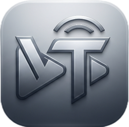

<div align="center">
  

  <h1>VoxTube</h1>

  <h3>A privacy-respecting YouTube and YouTube Music client for Android — with a Liquid Glass UI and a recommendation engine that stays on your phone.</h3>

  <p>
    <a href="https://github.com/argamerzz9582-debug/VoxTube/releases/latest/download/voxtube.apk"><b>Download APK</b></a> ·
    <a href="https://github.com/argamerzz9582-debug/VoxTube/releases/latest"><b>Releases</b></a> ·
    <a href="#license"><b>License</b></a>
  </p>
</div>

---

## Why VoxTube?

Most open-source YouTube clients give you playback but no way to discover new content. You either use the official app and get tracked, or you use an alternative and lose recommendations entirely.

VoxTube gives you both. The recommendation engine learns what you like by analyzing your watch behavior locally. It never leaves your device. You can inspect everything it knows about you, adjust it, or wipe it at any time.

---

## Features

### Video
- High-quality playback via ExoPlayer (Media3) with resolution switching (1080p, 720p, 480p, 360p)
- SponsorBlock — automatically skips sponsors, intros, outros, and filler
- DeArrow — replaces clickbait thumbnails and titles with community-sourced alternatives
- Return Youtube Dislike (RYD)
- Background playback — listen to audio with the screen off
- Picture-in-Picture — keep watching while using other apps
- Casting to smart TVs and streaming devices
- Playback speed control (0.25x to 2x)
- Video chapters with seek jumping
- Gesture controls for brightness, volume, and seeking
- Subtitles with customizable font size, color, and background
- Downloads with VP9, AV1, and standard format support
- Resume playback from where you left off

### Music
- Dedicated music player with album art and audio visualizations
- Queue management with add, remove, and reorder
- Shuffle and repeat (single/all)
- Persistent mini player across the app
- Synchronized lyrics display
- Fetches tracks from YouTube Music
- Playback speed control for music playback

### Recommendations (on-device Neuro engine)
- Runs 100% on-device — no server, no telemetry, no account needed
- Learns from what you watch, skip, like, dislike, search for, and how long you watch
- Distinguishes weekday and weekend patterns, morning and night preferences
- Detects when you're getting bored of a topic and mixes in new content
- Prevents your feed from collapsing into the same 2-3 topics
- Surfaces related videos from your recent watches to create natural topic transitions
- Uses engagement signals (like-to-view ratios) to filter out low-quality content
- Full transparency dashboard — see what the algorithm knows and why it recommended something
- Export/import your entire recommendation profile as a file

### Library
- Local watch history
- Favorites and custom playlists
- Shorts feed with bookmarking
- Continue watching shelf
- Subscription management with cached feeds

### Privacy
- No Google account required
- No ads, analytics, or tracking
- All data stored locally on your device
- Import subscriptions and history from NewPipe
- Export or delete everything at any time

### Appearance
- **Liquid Glass UI** — translucent, refractive tab bar, toolbars and sheets that bend the content behind them (full effect on Android 13+, frosted on Android 12, solid fallback on older devices)
- Softer, larger-radius shape system across the app
- 25+ colour palettes, Material You and custom themes — the glass picks up whichever palette you choose
- Built entirely with Jetpack Compose


---

## Screenshots

<div align="center">
  <table>
    <tr>
      <td align="center"><b>Home Feed</b><br></td>
      <td align="center"><b>Video Player</b><br></td>
      <td align="center"><b>Shorts</b><br></td>
    </tr>
  </table>
  <details>
    <summary><b>More screenshots</b></summary>
    <table>
      <tr>
        <td align="center"><b>Subscriptions</b><br></td>
        <td align="center"><b>Channel View</b><br></td>
        <td align="center"><b>Playlist</b><br></td>
      </tr>
      <tr>
        <td align="center"><b>Music Hub</b><br></td>
        <td align="center"><b>Music Player</b><br></td>
        <td align="center"><b>Lyrics</b><br></td>
      </tr>
      <tr>
        <td align="center"><b>Artist Page</b><br></td>
        <td align="center"><b>Album</b><br></td>
        <td align="center"><b>Your Library</b><br></td>
      </tr>
      <tr>
        <td align="center"><b>Your Taste</b><br></td>
        <td align="center"></td>
        <td align="center"></td>
      </tr>
    </table>
  </details>
</div>

> Screenshots show the pre-redesign UI and will be refreshed as the Liquid Glass redesign lands.

---

## Download

Get the latest version from the [Releases page](https://github.com/argamerzz9582-debug/VoxTube/releases/latest):

| File | What it is |
|---|---|
| [`voxtube.apk`](https://github.com/argamerzz9582-debug/VoxTube/releases/latest/download/voxtube.apk) | Universal GitHub build. Updates itself from inside the app. Pick this if unsure. |
| [`voxtube-arm64-v8a.apk`](https://github.com/argamerzz9582-debug/VoxTube/releases/latest/download/voxtube-arm64-v8a.apk) | Smaller GitHub build for most modern phones (64-bit ARM). |
| [`voxtube-armeabi-v7a.apk`](https://github.com/argamerzz9582-debug/VoxTube/releases/latest/download/voxtube-armeabi-v7a.apk) | Smaller GitHub build for older 32-bit phones. |
| [`voxtube-foss.apk`](https://github.com/argamerzz9582-debug/VoxTube/releases/latest/download/voxtube-foss.apk) | FOSS build: no built-in updater and no Discord integration. Per-ABI FOSS builds are on the release page too. |

Each release also links the full source code (zip and tar.gz). The application ID is `com.voxtube.app`.

**Minimum requirement:** Android 8.0+

---

## Building

```bash
./gradlew assembleGithubDebug   # or assembleFossDebug
```

Always use a flavor-prefixed task. See [CONTRIBUTING.md](CONTRIBUTING.md) and [AGENTS.md](AGENTS.md) for the code and design guidelines, including the Liquid Glass rules.

---

<a id="license"></a>
## License

**VoxTube** is Free Software: you can use, study, share, and improve it at your will.
It is distributed under the **GNU General Public License v3 (GPLv3)** — see [License](License).

VoxTube is a modified version of Flow (GPLv3). The copyright notices in the source files are kept as the GPLv3 requires.

> **For developers:** the GPLv3 requires that any project using this source code must also be open source under the GPLv3.
